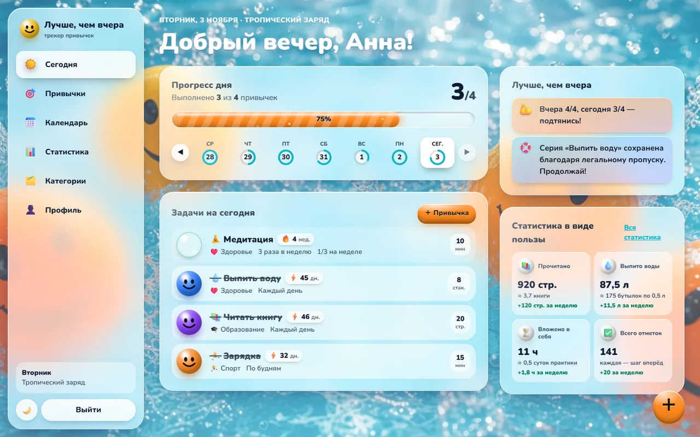
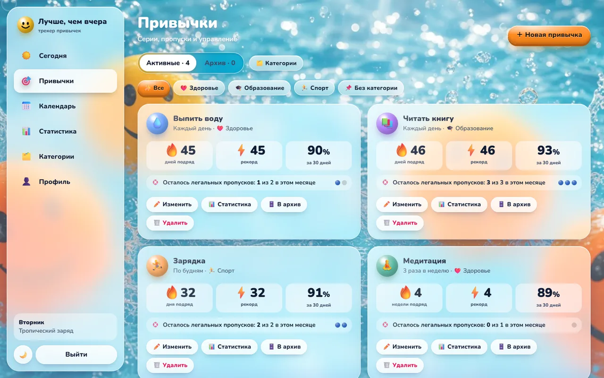
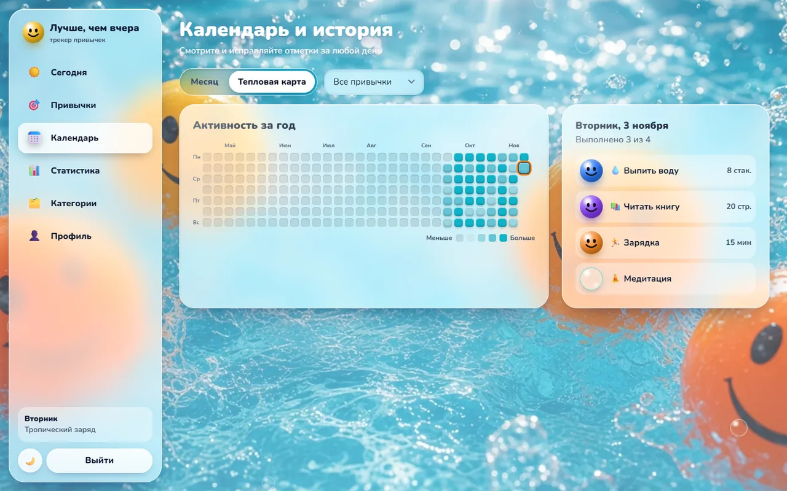
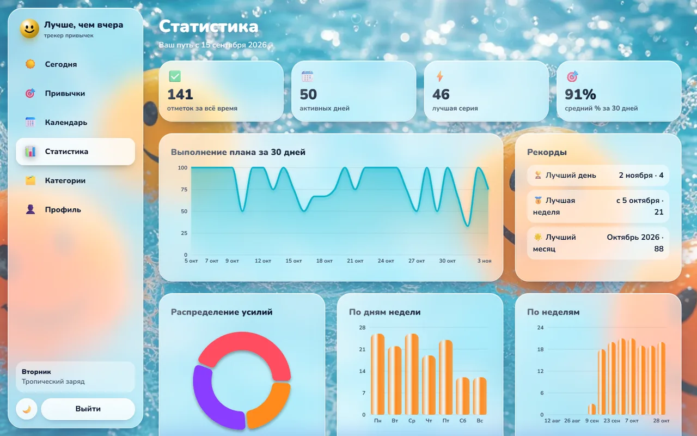
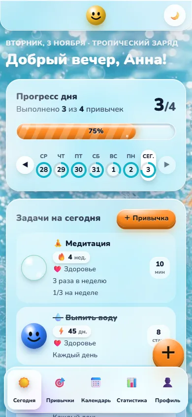

# Лучше, чем вчера

Персональный трекер привычек. Закрытое PWA-приложение без ленты, рейтингов и чужих глаз: свои привычки, свои серии и свой прогресс.

Фон живой и объёмный — глянцевые шарики в воде, отдельная позитивная сцена на каждый день недели. Отметка — это пузырёк, который превращается в улыбающийся шарик.

## Как выглядит

<p align="center">
  
</p>

**Сегодня** — приветствие, прогресс дня, задачи и польза на одном экране.

<p align="center">
  
</p>

**Привычки** — серии, рекорды, легальные пропуски и управление.

<p align="center">
  
</p>

**Календарь** — тепловая карта года и правка отметок за любой день.

<p align="center">
  
</p>

**Статистика** — серии, проценты, графики и рекорды.

<p align="center">
  
</p>

На телефоне — нижние вкладки (или бургер-меню, если включить его в профиле).

<p align="center">
  
</p>

## Что умеет

- **Сегодня** — приветствие, прогресс дня, список задач, ретро-ввод за прошлые даты, быстрое добавление привычки
- **«Лучше, чем вчера»** — мягкие подсказки о динамике и поддержка при пропусках
- **Польза** — страницы превращаются в книги, стаканы — в литры, минуты — в часы
- **Привычки** — ежедневно, по дням недели или N раз в неделю; единицы измерения; легальные пропуски; серии 🔥 и рекорды ⚡; архив
- **Категории** — девять стандартных плюс свои
- **Календарь** — тепловая карта и правка прошлых дней
- **Статистика** — текущая и лучшая серия, процент за 7 / 15 / 30 дней, графики
- **Профиль** — тема, навигация (нижние табы или бургер), фон, экспорт CSV/JSON, импорт, удаление данных
- **PWA** — установка на телефон и работа офлайн

Регистрация доступна только первому пользователю — владельцу. Дальше приложение закрыто.

## Запуск

```bash
npm install
npm run dev
```

Откроется [http://localhost:5173](http://localhost:5173).

| Команда | Что делает |
|---|---|
| `npm run build` | Сборка |
| `npm run preview` | Проверка сборки |
| `npm test` | Тесты |

Главный экран трекера — **Сегодня** (☀️). На лендинг с описанием можно попасть по адресу главной страницы в браузере.

## Стек

React, TypeScript, Vite, Tailwind CSS, React Router, Recharts. Данные хранятся локально в браузере.
